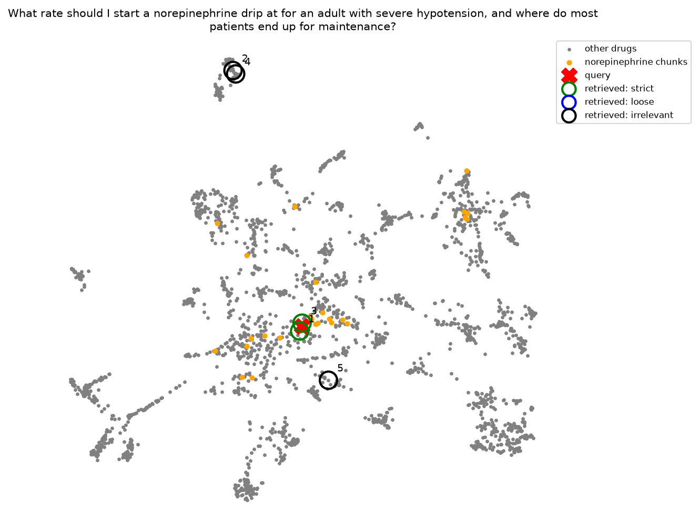
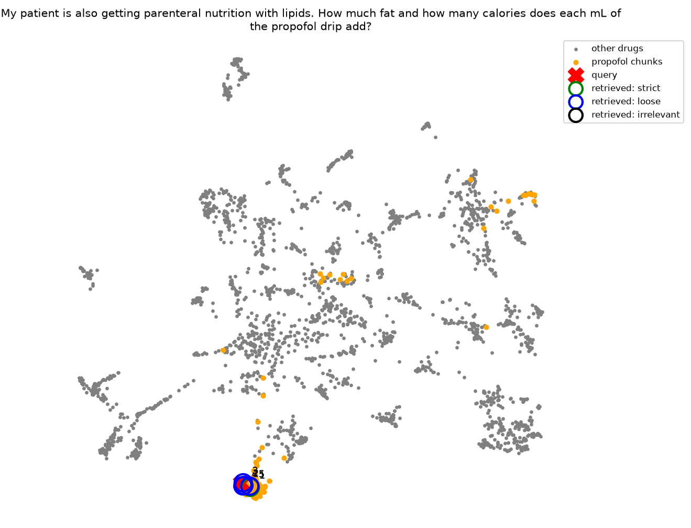
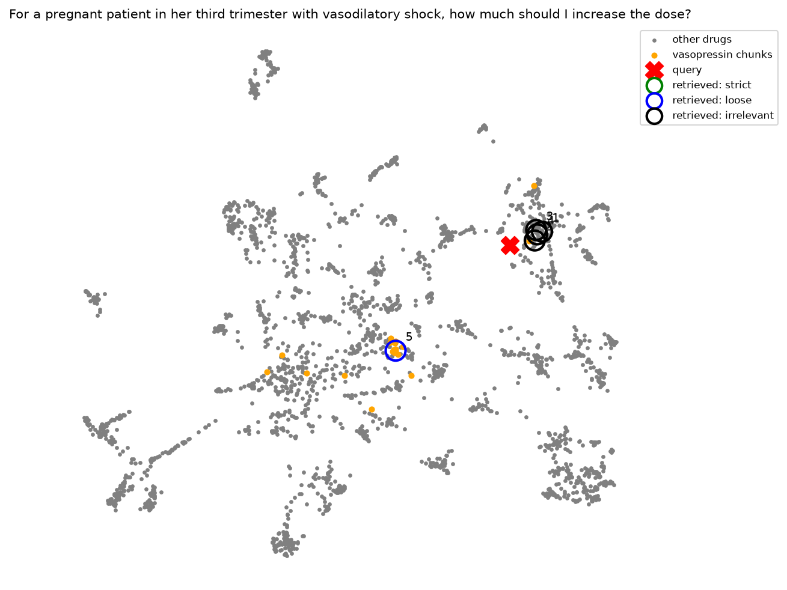
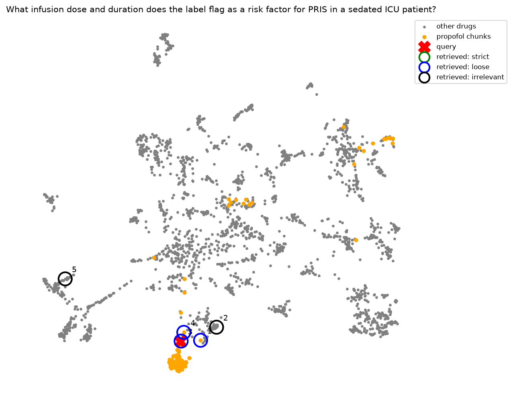
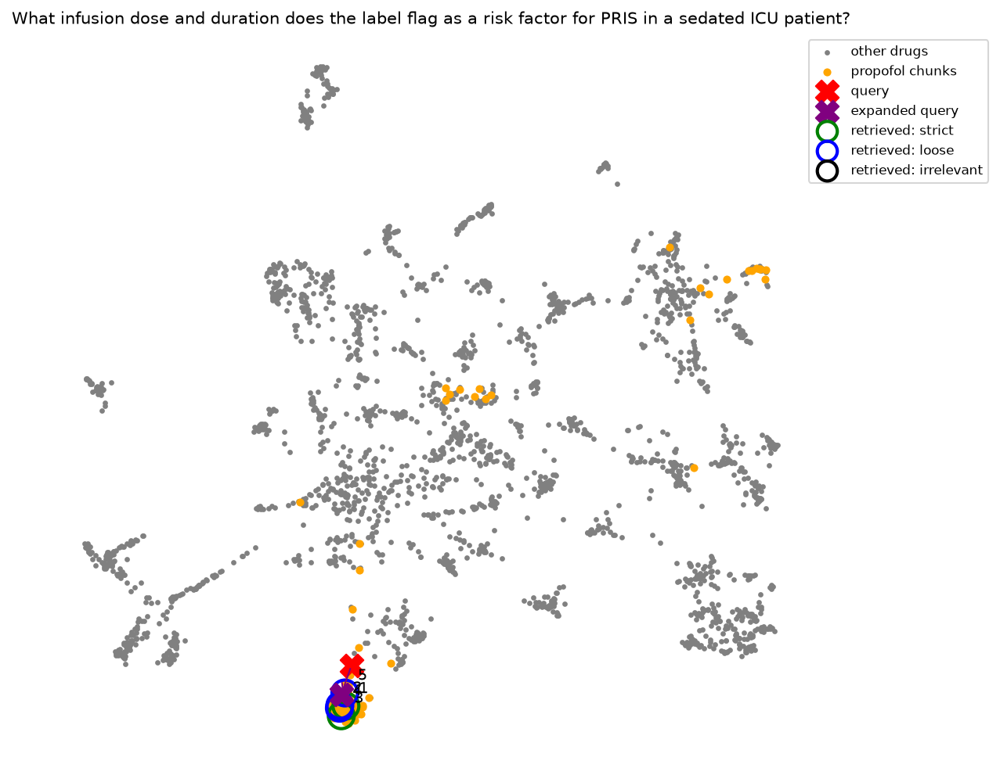

# uncertainty-aware-rag

A question-answering assistant over FDA drug labels for critical-care
medications that knows when it isn't sure, and says so instead of guessing.

*Research prototype. Not medical advice.*

## Why
In safety-critical settings, a confident wrong answer is worse than
"I don't know." This project builds a RAG system over drug labels,
measures where it fails, and adds an uncertainty layer so it can answer,
look further, or abstain.

## Status
- [x] Repo, environment (uv), secrets handling
- [x] Data: 47 openFDA drug labels, audited and frozen as a snapshot
- [x] Evaluation set: 44 questions with an answer key
- [x] RAG baseline: loading, section-aware chunking, Chroma index
- [x] Retrieval evaluation on the full question set
- [x] Retrieval improvement 1: query expansion with a generated answer
- [ ] Retrieval improvement 2: query expansion with multiple queries
- [ ] Retrieval improvement 3: re-ranking with a cross-encoder
- [ ] Retrieval improvement 4: filtering by drug
- [ ] Answer generation with citations and abstention
- [ ] Agent with tools (label search, adverse events, drug-name normalization)
- [ ] Deployment and monitoring

## Data
47 IV critical-care drug labels from openFDA: vasopressors, inotropes,
sedatives, analgesics, paralytics, antiarrhythmics, antihypertensives,
fluids, anticoagulants and electrolytes. The drug list is in
`config/drugs.csv`.

**Selection rules:** IV route only, single-ingredient products, newest
label per drug.

**Manual audit:** automated rules let through wrong products with
matching generic names. Fixed or excluded:
- albumin matched a radioactive imaging agent (fixed: search "albumin human")
- sodium chloride matched a dexmedetomidine premix (excluded)
- lidocaine matched a local anesthetic, not the IV antiarrhythmic (excluded)
- alteplase matched Cathflo, a catheter-clearing product (excluded)
- lactated Ringer's matched D5LR, a different fluid (excluded)

## Evaluation set
44 questions in `eval/questions.csv`:

| Type | Count | Purpose |
|---|---|---|
| Answerable | 24 | The label clearly states the answer |
| Ambiguous | 8 | The label is hedged or incomplete |
| Not in label | 8 | Realistic question the label doesn't answer |
| Out of library | 4 | Drug not in the library at all; should abstain |

Questions were drafted by an LLM from 8 focus-drug labels, with every
evidence quote verified word for word against the source
(`scripts/check_quotes.py`), then reviewed by a domain expert.
Out-of-library questions were written by hand.

## RAG pipeline (baseline)
    labels (JSON) -> sections -> chunks -> embeddings -> Chroma -> top-5 search

1. **Load** (`ingest.py`): 729 sections from 47 labels. Metadata and
   tables are skipped; subsections already contained in their parent
   section are dropped to avoid duplicates.
2. **Chunk** (`chunking.py`): each section is split on its own (never
   across sections or labels), 1000 characters then 256 tokens, giving
   2516 chunks tagged with drug and section.
3. **Index and search** (`index.py`): Chroma with the all-MiniLM-L6-v2
   embedding model.

## Retrieval baseline (32 questions)
Every answerable and ambiguous question was run through search (top 5).
Each retrieved chunk is judged automatically against the answer key:

- **strict**: right drug **and** right label section
- **loose**: right drug, any section
- **irrelevant**: wrong drug

| Metric | Strict | Loose | Plain meaning |
|---|---|---|---|
| Hit rate@5 | 0.66 | 0.91 | Search finds the right **drug** for 91% of questions, but the right **section** for only 66%. |
| Precision@5 | 0.20 | 0.60 | On average, only 1 of the 5 results is the right section; 3 of 5 are the right drug. |
| MRR | 0.46 | 0.78 | The first right-section result typically appears around rank 2. |

**Main finding:** search usually finds the right drug, then often picks
the wrong part of its label. For about a third of questions, the exact
answer location never appears in the top 5. Per-question results are in
`eval/results/retrieval_baseline.csv`.

### What retrieval looks like
Each chunk's embedding is projected to 2D with UMAP. Gray: all chunks.
Orange: chunks of the drug the question is about. Red X: the question.
Rings: the 5 retrieved chunks (green = strict, blue = loose,
black = irrelevant), numbered by rank.

<table>
  <tr>
    <td align="center"><b>Success</b> norepinephrine starting rate</td>
    <td align="center"><b>Right drug, wrong section</b> propofol fat and calories</td>
    <td align="center"><b>Wrong drug</b> vasopressin in pregnancy</td>
  </tr>
  <tr>
    <td></td>
    <td></td>
    <td></td>
  </tr>
</table>

- **Success:** the question lands among norepinephrine's dosing chunks;
  ranks 1 and 3 are the right section, ranks 2, 4 and 5 are other drugs.
- **Right drug, wrong section:** every result is propofol, but mostly from
  the wrong part of the label.
- **Wrong drug:** the question lands among *other drugs' pregnancy
  sections*; ranks 1 to 4 are other drugs. Only rank 5 is vasopressin,
  from the wrong section. "Pregnant" pulled the search more strongly than
  the drug name.

*Click any figure to see it full size.*

The orange dots are spread across the whole map: the embedding groups
text by **type of section** (dosing near dosing, pregnancy near
pregnancy) much more than by **drug**. That is the root cause of
wrong-drug retrieval.

*Caution:* UMAP squeezes 384 dimensions into 2, so distances in these
plots are distorted. The figures are for intuition; the metrics table
is the evidence.

## Improvement 1: query expansion with a generated answer

### The problem it targets
A clinician's question and the label text that answers it are written
in different styles. The question is short and conversational ("What
infusion dose and duration does the label flag as a risk factor for
PRIS?"); the label is formal ("Propofol infusion syndrome ... has been
associated with prolonged, high-dose infusions ..."). The embedding
model compares styles as well as meaning, so the question often lands
near the right drug but not on the right section.

### The method
Before searching, an LLM writes a short **imaginary answer**: 2 to 4
sentences that sound like the label section that would contain the
answer. The search then uses the question plus this imaginary answer.

    question -> LLM writes a label-style passage -> search with "question + passage"

The imaginary answer does not need to be correct. It only needs to
*sound like* the right section, so that the search lands in the right
neighborhood. It is used for search only and is never shown to a user.
(This idea is known as HyDE, Hypothetical Document Embeddings.)

- **LLM:** `openai/gpt-oss-120b` via Groq (`llm.py`, swappable).
- **Caching:** every generated answer is saved in
  `eval/results/generated_answers.json`, so runs are reproducible and
  cost nothing to repeat.
- **Retries:** only on temporary errors (429 rate limit, 503 busy),
  with a timeout and the SDK's hidden retries turned off.

### A failure found along the way: refusals
With the first instructions ("write a passage that would answer the
question"), the LLM refused **3 of 32** questions (fentanyl re-dosing,
norepinephrine infiltration, vasopressin in pregnancy). It treated them
as requests for medical advice. The refusal text ("I'm sorry, I can't
help with that") was then added to the search query and corrupted it.

Two fixes, in order:
1. **Fallback:** if the answer looks like a refusal, search with the
   original question only. A safe default that never makes things worse.
2. **Better instructions:** explain the real task to the LLM: write
   label-style search text that is never shown to anyone and is not
   medical advice. Result: **0 refusals**.

Lesson: an LLM inside a pipeline can fail *silently*. Its output must
be checked before it is used.

### Results (32 questions)

| Metric | Baseline strict | Generated strict | Baseline loose | Generated loose |
|---|---|---|---|---|
| Hit rate@5 | 0.66 | **0.78** | 0.91 | **0.94** |
| Precision@5 | 0.20 | **0.28** | 0.60 | **0.69** |
| MRR | 0.46 | **0.62** | 0.78 | **0.83** |

Per question (strict):
- **4 gains, 0 losses** in hit rate: amiodarone_q2, dexmedetomidine_q4,
  fentanyl_q2 and propofol_q1 now find the right section in the top 5.
  The method fixed 4 of the 11 baseline misses.
- The first correct result moved **earlier for 12 questions** and
  **later for 3**.
- It helped both answerable questions (hit rate 0.71 to 0.83) and
  ambiguous ones (0.50 to 0.62).

Per-question results are in `eval/results/retrieval_generated.csv`.

### What it looks like
Same question (propofol_q1), before and after. Purple X: the expanded
query.

<table>
  <tr>
    <td align="center"><b>Baseline</b> question only</td>
    <td align="center"><b>Query expansion</b> question + generated answer</td>
  </tr>
  <tr>
    <td></td>
    <td></td>
  </tr>
</table>

- **Baseline:** the question lands just outside the dense propofol
  cluster. No result is the right section, and 2 of 5 are other drugs.
- **Query expansion:** the expanded query moves into the cluster.
  All 5 results are propofol, and the right section is ranked first.

### Limits and risks
- **Small sample:** 32 questions, so a change of one question moves hit
  rate by 3 points. The gains are consistent but not proven at scale.
- **Run-to-run variation:** the LLM writes slightly different text each
  time; regenerating all answers changed precision by a few points.
  Caching keeps one run fixed for comparison.
- **Hallucinated details:** imaginary answers can contain made-up doses.
  This is acceptable only because they are used for search and never
  shown. They must never reach the final answer.
- **Cost and latency:** one extra LLM call per question.
- **It doesn't fix wrong-drug retrieval at its root.** The embedding
  still groups by section type; filtering by drug is the planned fix.

## Known issues
- **The token splitter alters text.** It lowercases text and changes
  spacing: in one chunk, "1,500 units/hour" became "1, 500 units / hour".
  Planned fix: a splitter that returns exact slices of the original text,
  plus a test that every chunk appears word for word in its source.

## Next steps
- Query expansion with multiple queries: the LLM writes several related
  questions; search with each and combine the results.
- Re-ranking with a cross-encoder.
- Filtering by drug, then hybrid search.
- Fix the token splitter and re-measure.

## Quick start
    uv sync
    copy .env.example .env      # then add your openFDA and Groq API keys
    uv run python scripts/fetch_labels.py
    uv run python -m uncertainty_aware_rag.index
    uv run python -m uncertainty_aware_rag.evaluate baseline
    uv run python -m uncertainty_aware_rag.evaluate generated
    uv run python -m uncertainty_aware_rag.plot propofol_q1
    uv run python -m uncertainty_aware_rag.plot propofol_q1 generated

## Project structure
    config/         drug list
    data/labels/    label snapshot (openFDA, Oct 2026)
    eval/           evaluation questions and results (incl. cached LLM answers)
    docs/figures/   retrieval plots
    scripts/        data tools: fetcher, question merge, quote check
    src/            the pipeline: ingest, chunking, index, llm, expansion,
                    evaluate, plot
