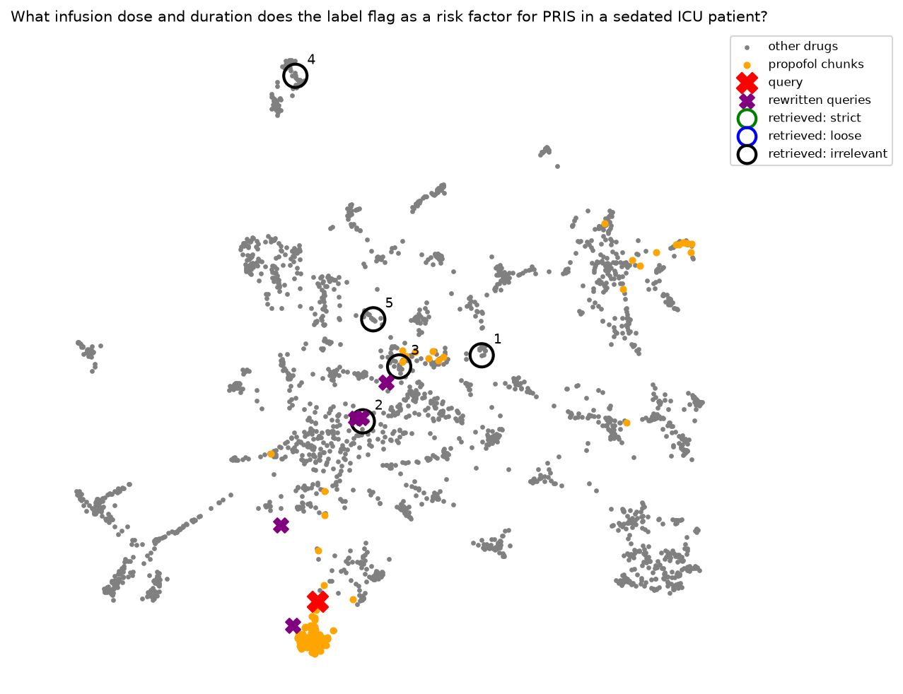

# uncertainty-aware-rag

A question-answering assistant over FDA drug labels for critical-care
medications that knows when it isn't sure, and says so instead of guessing.

*Research prototype. Not medical advice.*

## Why
In safety-critical settings, a confident wrong answer is worse than
"I don't know." This project builds a RAG system over drug labels,
measures where it fails, and adds an uncertainty layer so it can answer,
look further, or abstain.

## Status
- [x] Repo, environment (uv), secrets handling
- [x] Data: 47 openFDA drug labels, audited and frozen as a snapshot
- [x] Evaluation set: 44 questions with an answer key
- [x] RAG baseline: loading, section-aware chunking, Chroma index
- [x] Retrieval evaluation on the full question set
- [x] Retrieval improvement: query expansion (imaginary answer, multiple queries)
- [ ] Retrieval improvement: re-ranking with a cross-encoder
- [ ] Retrieval improvement: filtering by drug
- [ ] Answer generation with citations and abstention
- [ ] Agent with tools (label search, adverse events, drug-name normalization)
- [ ] Deployment and monitoring

## Data
The library holds 47 FDA drug labels for IV medications used in critical
care, downloaded from openFDA: vasopressors, inotropes, sedatives,
analgesics, paralytics, antiarrhythmics, antihypertensives, fluids,
anticoagulants and electrolytes (full list in `config/drugs.csv`). For
each drug, the fetch script keeps only IV, single-ingredient products and
picks the newest label. Searching by generic name alone turned out to be
unreliable, because the same name can belong to a very different product.
A manual check of every downloaded label caught five such mismatches:

- **Albumin** returned a radioactive imaging agent. Fixed by searching for "albumin human".
- **Lidocaine** returned a local anesthetic instead of the IV antiarrhythmic. Excluded.
- **Alteplase** returned Cathflo, a low-dose product for clearing blocked catheters. Excluded.
- **Sodium chloride** returned a dexmedetomidine premix diluted in saline. Excluded.
- **Lactated Ringer's** returned D5LR, a different fluid that also contains dextrose. Excluded.

Lesson: automated filters can pass the wrong product without any error,
so data has to be checked by eye before it is trusted.

## Evaluation set
44 questions in `eval/questions.csv`:

| Type | Count | Purpose |
|---|---|---|
| Answerable | 24 | The label clearly states the answer |
| Ambiguous | 8 | The label is hedged or incomplete |
| Not in label | 8 | Realistic question the label doesn't answer |
| Out of library | 4 | Drug not in the library at all; should abstain |

Questions were drafted by an LLM from 8 focus-drug labels, with every
evidence quote verified word for word against the source
(`scripts/check_quotes.py`), then reviewed by a domain expert.
Out-of-library questions were written by hand.

## RAG pipeline (baseline)
    labels (JSON) -> sections -> chunks -> embeddings -> Chroma -> top-5 search

1. **Load** (`ingest.py`): 729 sections from 47 labels. Metadata and
   tables are skipped; subsections already contained in their parent
   section are dropped to avoid duplicates.
2. **Chunk** (`chunking.py`): each section is split on its own (never
   across sections or labels), 1000 characters then 256 tokens, giving
   2516 chunks tagged with drug and section.
3. **Index and search** (`index.py`): Chroma with the all-MiniLM-L6-v2
   embedding model.

## Retrieval baseline (32 questions)
Every answerable and ambiguous question was run through search (top 5).
Each retrieved chunk is judged automatically against the answer key:

- **strict**: right drug **and** right label section
- **loose**: right drug, any section
- **irrelevant**: wrong drug

| Metric | Strict | Loose | Plain meaning |
|---|---|---|---|
| Hit rate@5 | 0.66 | 0.91 | Search finds the right **drug** for 91% of questions, but the right **section** for only 66%. |
| Precision@5 | 0.20 | 0.60 | On average, only 1 of the 5 results is the right section; 3 of 5 are the right drug. |
| MRR | 0.46 | 0.78 | The first right-section result typically appears around rank 2. |

**Main finding:** search usually finds the right drug, then often picks
the wrong part of its label. For about a third of questions, the exact
answer location never appears in the top 5. Per-question results are in
`eval/results/retrieval_baseline.csv`.

### What retrieval looks like
Each chunk's embedding is projected to 2D with UMAP. Gray: all chunks.
Orange: chunks of the drug the question is about. Red X: the question.
Rings: the 5 retrieved chunks (green = strict, blue = loose,
black = irrelevant), numbered by rank.

<table>
  <tr>
    <td align="center"><b>Success</b> norepinephrine starting rate</td>
    <td align="center"><b>Right drug, wrong section</b> propofol fat and calories</td>
    <td align="center"><b>Wrong drug</b> vasopressin in pregnancy</td>
  </tr>
  <tr>
    <td></td>
    <td></td>
    <td></td>
  </tr>
</table>

- **Success** (*"What rate should I start a norepinephrine drip at...?"*):
  the question lands among norepinephrine's dosing text. Ranks 1 and 3
  come from the right section (Dosage and Administration); ranks 2, 4 and
  5 are other drugs' dosing sections, which look similar to the model.
- **Right drug, wrong section** (*"How much fat and how many calories does
  each mL of propofol add?"*): all 5 results are from the propofol label,
  but mostly from the wrong section. The answer sits under Warnings and
  Precautions, while the results come from parts of the label that
  mention lipids more generally.
- **Wrong drug** (*"For a pregnant patient in her third trimester with
  vasodilatory shock, how much should I increase the dose?"*): the
  question never names vasopressin, so the search can only match on
  "pregnancy" and "shock." It lands among other drugs' pregnancy sections:
  ranks 1 to 4 are other drugs, and only rank 5 is vasopressin, from the
  wrong section. Without the drug name, there is nothing to point the
  search to the right label. This is why filtering by drug is planned.

*Click any figure to see it full size.*

*Caution:* UMAP squeezes 384 dimensions into 2, so distances in these
plots are distorted. The figures are for intuition; the metrics table
is the evidence.

## Retrieval improvements: query expansion
A clinician's question and the label text that answers it are written in
different styles (short and conversational vs. formal label language).
The embedding compares style as well as meaning, so the question often
lands near the right drug but not on the right section. Query expansion
uses an LLM to rewrite the query before searching. Two methods were
tried. Both methods add an LLM to the pipeline **before the search**. The LLM
rewrites the user's question into a better search query; the search
itself does not change.

**Method 1: imaginary answer** (also called HyDE). The LLM writes a short
passage that sounds like the label section that would answer the
question. The search then uses the question plus this passage. The
passage does not need to be correct, only to sound like the right
section. It is used for search only and is never shown to anyone.

**Method 2: multiple queries.** The LLM rewrites the question in up to 5
different ways. The original and each rewrite are searched separately,
and the 6 result lists are combined into one top 5 using Reciprocal Rank
Fusion (RRF): a chunk ranks higher if it appears near the top of several
lists.

Both use `openai/gpt-oss-120b` via Groq (`llm.py`). Every LLM output is
cached in `eval/results/` so runs are reproducible, and calls are retried
only on temporary errors (429, 503).

### Results (32 questions)

**Table 1.** Retrieval metrics for each method (strict = right drug and
right section; loose = right drug, any section).

<table>
  <tr>
    <th rowspan="2">Metric</th>
    <th colspan="2">Baseline</th>
    <th colspan="2">Imaginary answer</th>
    <th colspan="2">Multiple queries</th>
  </tr>
  <tr>
    <th>strict</th><th>loose</th>
    <th>strict</th><th>loose</th>
    <th>strict</th><th>loose</th>
  </tr>
  <tr>
    <td>Hit rate@5</td>
    <td>0.66</td><td>0.91</td>
    <td><b>0.78</b></td><td><b>0.94</b></td>
    <td>0.69</td><td>0.88</td>
  </tr>
  <tr>
    <td>Precision@5</td>
    <td>0.20</td><td>0.60</td>
    <td><b>0.28</b></td><td><b>0.69</b></td>
    <td>0.23</td><td>0.62</td>
  </tr>
  <tr>
    <td>MRR</td>
    <td>0.46</td><td>0.78</td>
    <td><b>0.62</b></td><td><b>0.83</b></td>
    <td>0.48</td><td>0.78</td>
  </tr>
</table>

As Table 1 shows, the _imaginary answer_ is the clear winner: it improves
every metric, gives 4 questions the right section in the top 5, and
loses none. _Multiple queries_ helps much less: it also fixes 4 questions
(including nicardipine_q4, which no other method fixes) but breaks 3
others, so its metrics end up close to the _baseline_. These results are
confirmed by the example in Figure 1, which shows the same question under
all three methods. The question asks about PRIS, propofol's infusion
syndrome, without naming propofol. With the baseline (a), the question
lands just outside the propofol cluster: all results are propofol, but
none is the right section. With the _imaginary answer_ (b), the label-style
passage moves the query into the cluster, and the right section is ranked
first. With _multiple queries_ (c), most rewrites keep only general words
such as "infusion dose" and "duration," so they land among other drugs'
dosing text. Together they outvote the original question, and all 5
results are other drugs. Extra rewrites bring in more candidates but also
more noise, and simple voting cannot pick the best 5. This is why the
method is usually paired with _re-ranking_, the next step.

**Figure 1.** One question (propofol_q1) under each method. Red X: the
question; purple X: the expanded query or rewrites; rings: the top 5
results (green = right section, blue = right drug, black = other drug).

<table>
  <tr>
    <td align="center"><b>(a) _Baseline_</b></td>
    <td align="center"><b>(b) _Imaginary answer_</b></td>
    <td align="center"><b>(c) _Multiple queries_</b></td>
  </tr>
  <tr>
    <td></td>
    <td></td>
    <td></td>
  </tr>
</table>

### Failures found along the way
- **Refusals.** The first _imaginary-answer_ instructions made the LLM
  refuse 3 of 32 questions as "medical advice," and the refusal text
  ("I'm sorry, I can't...") was searched as if it were label text.
  Fixed by a fallback to the plain question, then by explaining the real
  task (search text, never shown to anyone): 0 refusals.
- **Invented drugs.** A first version of the multi-query instructions
  said "keep the drug name in every question." When the question named
  no drug, the LLM made one up: all 5 rewrites of a vasopressin question
  said "norepinephrine," and RRF treated the repeated mistake as
  agreement. "Dex" was also read as dexamethasone instead of
  dexmedetomidine. Removing that rule fixed the invented names, but
  traded some strict accuracy for wider coverage.
- **Questions without a drug name.** Some evaluation questions ("Can I
  run *this* through the same line...") only make sense if the drug is
  known from context. In a real app the drug would come from the screen
  the clinician is on; this motivates filtering by drug.

**Lesson:** an LLM inside a pipeline can fail silently. Its output must be
checked before it is used, and a method that repeats the same LLM call
can amplify one mistake.

### Limits
- 32 questions: one question moves hit rate by 3 points. The instructions
  were not tuned further, to avoid fitting them to this test set.
- LLM output varies between runs; caching fixes one run for comparison.
- Imaginary answers can contain made-up doses. Acceptable only because
  they are used for search and never shown.
- One extra LLM call per question (cost and latency).

## Known issues
- **The token splitter alters text.** It lowercases text and changes
  spacing: in one chunk, "1,500 units/hour" became "1, 500 units / hour".
  Planned fix: a splitter that returns exact slices of the original text,
  plus a test that every chunk appears word for word in its source.

## Next steps
- Re-ranking with a cross-encoder, replacing RRF voting for multiple
  queries.
- Filtering by drug, then hybrid search.
- Fix the token splitter and re-measure.

## Quick start
    uv sync
    copy .env.example .env      # then add your openFDA and Groq API keys
    uv run python scripts/fetch_labels.py
    uv run python -m uncertainty_aware_rag.index
    uv run python -m uncertainty_aware_rag.evaluate baseline
    uv run python -m uncertainty_aware_rag.evaluate generated
    uv run python -m uncertainty_aware_rag.evaluate multi
    uv run python -m uncertainty_aware_rag.plot propofol_q1
    uv run python -m uncertainty_aware_rag.plot propofol_q1 generated

## Project structure
    config/         drug list
    data/labels/    label snapshot (openFDA, Oct 2026)
    eval/           evaluation questions and results (incl. cached LLM answers)
    docs/figures/   retrieval plots
    scripts/        data tools: fetcher, question merge, quote check
    src/            the pipeline: ingest, chunking, index, llm, expansion,
                    evaluate, plot
